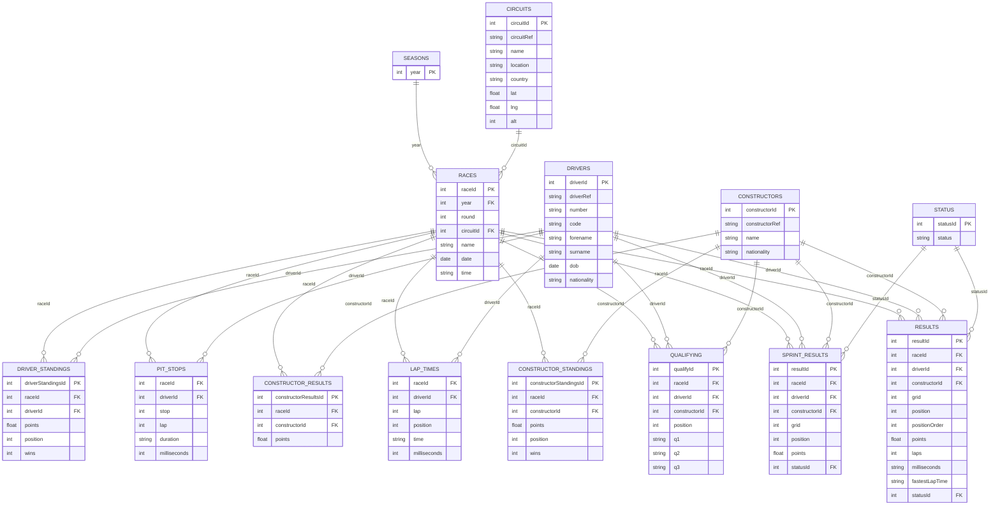

# Modelo semântico do dataset de Fórmula 1

O dataset do Kaggle é uma cópia do banco Ergast: 14 tabelas ligadas por chaves numéricas
(`raceId`, `driverId`, `constructorId`, `circuitId`, `statusId`). Os nomes das colunas abaixo são
os dos arquivos CSV. **Confirme na sua workspace** com `DESCRIBE bronze_<tabela>`, porque o autor
do dataset pode ter mudado algo.

## Como ler

- **Dimensões** (quem, onde, quando): `drivers`, `constructors`, `circuits`, `races`, `seasons`, `status`.
- **Fatos** (o que aconteceu): `results`, `qualifying`, `lap_times`, `pit_stops`, `sprint_results`,
  além das classificações do campeonato (`driver_standings`, `constructor_standings`,
  `constructor_results`).
- A corrida (`races`) é o centro: quase todo fato aponta para ela por `raceId`.
- `results` é a tabela mais usada nas perguntas do dia: uma linha por piloto em cada corrida.

## Onde cada story entra

| Story | Entrada | Saída (silver) |
|---|---|---|
| 1. Pilotos | `drivers` | `silver_dim_driver` |
| 2. Corridas e circuitos | `races` + `circuits` | `silver_dim_race` |
| 3. Resultados | `results` + `status` | `silver_fact_results` |
| Professora (gold) | as três silvers | KPIs e painel |

Na gold, `silver_fact_results` liga a `silver_dim_driver` por `driver_id` e a `silver_dim_race` por
`race_id`: é a estrela do projeto.

## Pegadinhas conhecidas

- O nulo vem como o texto `\N`, não como vazio.
- `grid = 0` significa largada dos boxes (não existe posição 0).
- `position` fica nulo quando o piloto não terminou (veja `positionText`, que traz `R`, `D`, `W`...).
- Tempos vêm como texto (`1:27.452`), e `milliseconds` só existe para quem completou a corrida inteira.
